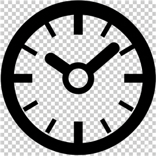
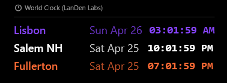
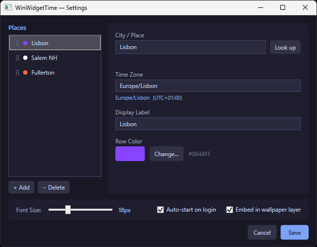

# WinWidgetTime

A lightweight, transparent world clock widget for your desktop. It shows the live time for as many
cities as you like, right on your wallpaper.

- **Multi-city clock:** one row per city, updated every second, with its own label, color and
  date/time format (12 or 24 hour).
- **Easy city lookup:** type a city name and press Enter to fill in its time zone, or type a time
  zone ID yourself. Enter `Local` to follow your PC's own time zone.
- **Yours to style:** background color, opacity, font size and title bar. Run several widgets on
  several monitors, and each remembers where it goes.
- **Private by design:** no account, no ads, no telemetry. The only internet request is the city
  lookup you start yourself, which sends the city name you typed to OpenStreetMap. See the
  [privacy policy](privacy.html).
- **Free and open source** under the Apache 2.0 license.

## Download

Windows 10 or 11, x64 or ARM64. No .NET runtime needed.

- [Download the portable zip](https://github.com/landenlabs/win-widget-time/releases/latest/download/WinWidgetTime.zip):
  extract it and run `WinWidgetTime.exe`
- [All releases](https://github.com/landenlabs/win-widget-time/releases): MSIX installers (x64 and
  ARM64) and older versions
- [Installation help](https://github.com/landenlabs/win-widget-time/blob/main/how-to-install.md)

## Using it

| Action | Result |
| --- | --- |
| Hover | Shows the Settings (⚙) and About (?) buttons |
| Drag the widget | Moves it (Windows 11; on Windows 10 use the position map in Settings) |
| Drag a bottom corner | Resizes it by scaling the font (top corners too when the title bar is hidden) |
| Right-click | Settings, About, Remove Widget, Exit |
| System tray icon | Add another widget, open Settings, or exit |

## Support

- [Report a problem or ask a question](https://github.com/landenlabs/win-widget-time/issues)
- [Source code and documentation](https://github.com/landenlabs/win-widget-time)
- [Privacy policy](privacy.html)

&copy; 2026 LanDen Labs. Licensed under Apache-2.0.
